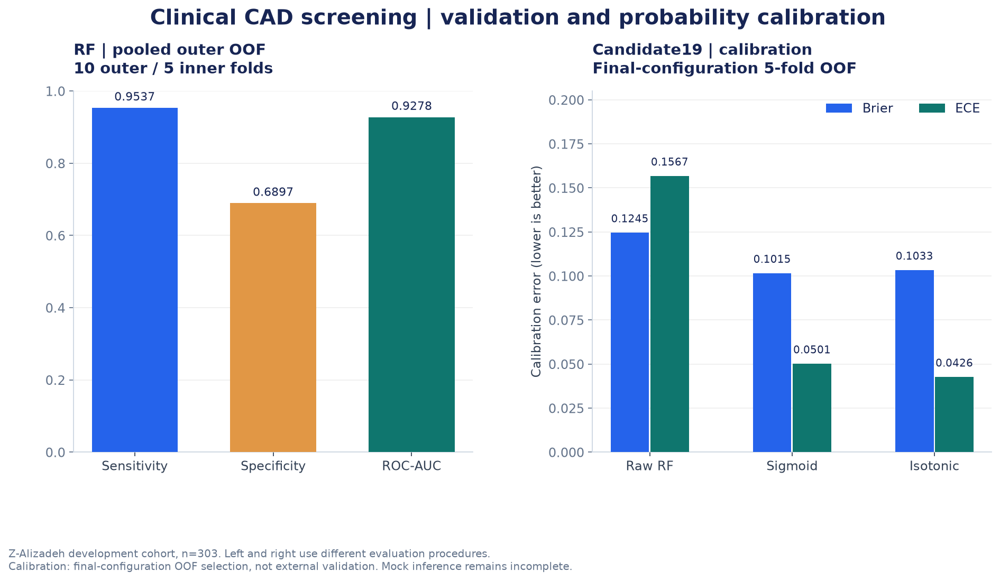

# 임상정보 기반 관상동맥질환 선별: Random Forest 모델 비교와 확률 보정

임상 데이터를 활용해 관상동맥질환(Coronary Artery Disease, CAD) 선별을 위한 머신러닝 모델을 개발하고, 성능 평가와 확률 보정을 진행한 프로젝트입니다.

Extension of Z-Alizadeh Sani 데이터셋을 이용해 데이터 전처리와 여러 분류 모델의 성능을 비교했습니다. 특히 소규모 데이터에서 발생할 수 있는 과적합과 평가 결과의 편향을 줄이기 위해 Nested Cross-Validation을 적용했습니다.

이후 Random Forest를 중심으로 모델을 구성하고, 예측 확률을 더 안정적으로 해석할 수 있는지 확인하기 위해 Sigmoid와 Isotonic Calibration을 비교했습니다.

## 데이터 출처

이 프로젝트는 [UCI Extension of Z-Alizadeh Sani 데이터셋](https://archive.ics.uci.edu/dataset/411/extention+of+z+alizadeh+sani+dataset)을 사용했습니다.

- **전체 데이터:** 303명
- **CAD:** 216명
- **Normal:** 87명
- **예측 대상:** 관상동맥질환(CAD) 여부
- **데이터 유형:** 임상정보 및 검사 결과

원본 데이터의 배포 조건은 CC BY 4.0이며, 상세 정보는 [UCI 데이터셋 페이지](https://doi.org/10.24432/C5461K)에서 확인할 수 있습니다.

이 저장소에는 실험 코드와 집계 결과를 정리했으며, 원본 임상 데이터와 환자별 예측 결과, 학습된 모델 파일은 포함하지 않았습니다.

## 1. 프로젝트 배경

의료 데이터를 이용해 질환을 예측할 때는 Accuracy나 AUROC와 같은 평가 지표뿐 아니라, 실제 질환이 있는 환자를 얼마나 놓치지 않는지도 중요합니다.

특히 CAD 선별을 목적으로 한다면 질환이 있는 환자를 정상으로 분류하는 False Negative(FN)를 주의해서 살펴봐야 한다고 생각했습니다.

처음에는 Logistic Regression과 Decision Tree 등 기본적인 분류 모델을 학습하며 데이터의 특성을 확인했습니다.

그러나 303명이라는 비교적 작은 데이터에서 단일 Train/Test 분할 결과만으로 모델을 선택하기에는 한계가 있었습니다.

이를 보완하기 위해 교차검증 방식을 변경하고, **민감도(Sensitivity)를 우선 고려하면서 특이도(Specificity)와 전반적인 분류 성능을 비교**하는 방향으로 실험을 진행했습니다.

## 2. 데이터 전처리와 변수 구성

### 2.1 데이터 누수 가능성 확인

예측 대상은 `Cath` 변수이며, Normal을 0, CAD를 1로 변환했습니다.

전처리 과정에서는 모델의 성능을 부풀릴 수 있는 데이터 누수(Data Leakage)를 먼저 확인했습니다.

`LAD`, `LCX`, `RCA`는 관상동맥질환의 결과와 직접 연결되는 정보이기 때문에 입력 변수에서 제외했습니다.

또한 값이 일정한 `Exertional CP` 변수도 제거했습니다.

### 2.2 범주형 변수 처리

범주형 변수는 데이터 특성에 따라 인코딩 방식을 구분했습니다.

- **BBB:** One-Hot Encoding
- **VHD:** Ordinal Encoding
- **기타 입력 변수:** 기존 데이터 구조와 변수 유형을 고려해 전처리

전처리 및 인코딩을 거쳐 원본 54개 입력 변수를 모델 입력용 55개 변수로 구성했습니다.

### 2.3 초기 모델 탐색

초기에는 데이터를 80:20으로 분할해 Logistic Regression과 Decision Tree를 비교했습니다.

이 과정에서 제한 없는 Decision Tree는 Train Accuracy가 1.0인 반면, Test Accuracy는 0.7049로 차이가 크게 나타났습니다.

학습 데이터에 대한 적합도가 높다고 해서 새로운 데이터에서도 좋은 성능을 보장하는 것은 아니었습니다.

또한 작은 Test 데이터를 반복해서 확인하며 모델과 하이퍼파라미터를 선택하면 평가 결과에 편향이 생길 수 있다고 판단했습니다.

이후 모델 선택과 평가 과정을 분리하기 위해 Nested Cross-Validation을 적용했습니다.

## 3. Nested Cross-Validation을 이용한 모델 비교

### 3.1 검증 방법

모델을 비교할 때는 Outer 10-fold와 Inner 5-fold로 구성된 Nested Cross-Validation을 사용했습니다.

- **Outer 10-fold:** 모델 성능 평가
- **Inner 5-fold:** 후보 모델과 Threshold 선택
- **평가 기준:** Sensitivity를 우선 고려하고 Specificity, PR-AUC, ROC-AUC 등을 함께 비교

Inner Fold의 OOF(Out-of-Fold) 예측에서 Sensitivity 95% 이상을 우선 만족하는 Threshold를 찾고, 다른 지표도 함께 검토했습니다.

이렇게 선택한 모델과 Threshold를 해당 Outer Fold의 평가 데이터에 적용했습니다.

각 Outer Fold마다 Threshold가 달라질 수 있기 때문에 전체 OOF 결과에 하나의 공통 Threshold를 적용한 것은 아닙니다.

### 3.2 모델 성능 비교

| 모델 | Sensitivity | Specificity | PR-AUC(AP) | ROC-AUC |
|---|---:|---:|---:|---:|
| XGBoost | 0.9444 | 0.5977 | 0.9513 | 0.9012 |
| **Random Forest** | **0.9537** | **0.6897** | **0.9709** | **0.9278** |
| Keras ANN | 0.9352 | 0.5632 | 0.9609 | 0.9050 |

이번 내부 검증에서는 Random Forest가 비교 대상 가운데 가장 높은 Sensitivity, Specificity, PR-AUC, ROC-AUC를 기록했습니다.

Random Forest의 Sensitivity는 0.9537로, CAD 환자 216명 중 206명을 양성으로 분류하고 10명을 놓친 결과였습니다.

이러한 결과를 바탕으로 이후 실험에서는 Random Forest를 중심으로 모델 구성을 진행했습니다.

다만 위 결과는 Nested CV를 이용한 내부 평가이며, 독립적인 외부 데이터에서 검증한 성능은 아닙니다.

## 4. Random Forest 모델 구성과 확률 보정

### 4.1 최종 모델 후보 비교

Nested CV를 통한 모델 비교 이후에는 Random Forest의 세부 설정과 확률 보정 방법을 추가로 검토했습니다.

전체 개발 데이터 303명을 이용한 **별도의 5-fold OOF 실험**에서 Random Forest 후보 24개를 비교했고, Candidate 19를 선택했습니다.

선택한 주요 설정은 다음과 같습니다.

| Hyperparameter | Value |
|---|---|
| n_estimators | 400 |
| max_depth | 12 |
| min_samples_split | 10 |
| min_samples_leaf | 8 |
| max_features | sqrt |
| criterion | entropy |
| class_weight | balanced_subsample |

이 과정은 앞서 진행한 Outer 10-fold Nested CV와 구분되는 별도의 모델 구성 단계입니다.

### 4.2 확률 보정이 필요한 이유

Random Forest의 분류 성능이 좋더라도 출력한 확률 자체가 실제 발생 가능성과 잘 일치하는지는 별도로 확인해야 합니다.

예를 들어 모델이 CAD 확률을 0.8로 예측했다고 해서, 그 확률이 실제로 얼마나 잘 보정되어 있는지는 AUROC만으로 판단할 수 없습니다.

따라서 분류 성능과 함께 예측 확률의 품질을 살펴보기 위해 두 가지 보정 방법을 비교했습니다.

- **Sigmoid Calibration:** 로지스틱 함수를 이용한 확률 보정
- **Isotonic Calibration:** 단조 증가 관계를 이용한 비모수적 확률 보정

보정 결과는 Brier Score와 Expected Calibration Error(ECE)를 중심으로 확인했습니다.

두 지표는 값이 낮을수록 좋은 방향으로 해석하지만, 모델 선택 시에는 민감도·특이도·AUROC의 변화도 함께 고려했습니다.

### 4.3 보정 결과 비교

| 방법 | Sensitivity | Specificity | ROC-AUC | Brier | ECE |
|---|---:|---:|---:|---:|---:|
| Raw RF | 0.9537 | 0.6782 | 0.9177 | 0.1245 | 0.1567 |
| **RF + Sigmoid** | **0.9583** | **0.6782** | 0.9127 | **0.1015** | 0.0501 |
| RF + Isotonic | 0.9537 | 0.6667 | 0.9170 | 0.1033 | **0.0426** |

### 결과 분석

Sigmoid Calibration을 적용했을 때 Brier Score는 0.1245에서 0.1015로 감소했고, ECE도 0.1567에서 0.0501로 개선됐습니다.

또한 Specificity는 0.6782로 유지하면서 Sensitivity는 0.9537에서 0.9583으로 증가했습니다.

이에 따라 False Negative는 10명에서 9명으로 줄었습니다.

반면 ROC-AUC는 0.9177에서 0.9127로 소폭 낮아졌습니다.

Isotonic Calibration은 ECE가 가장 낮았지만, Specificity가 감소하는 결과를 보였습니다.

최종적으로 확률 보정 정도와 분류 지표의 변화를 함께 고려해 **Sigmoid Calibration을 선택했습니다.**

다만 Random Forest 후보, 보정 방법, Threshold를 동일한 개발 OOF 결과를 참고해 선택했으므로, 이 결과를 독립적인 최종 검증 성능으로 해석할 수는 없습니다.

## 5. 모델 저장 및 입력 구조 확인

선택한 Random Forest + Sigmoid 모델을 전체 개발 데이터로 학습한 뒤, 모델과 함께 다음 정보를 저장했습니다.

- 모델 및 확률 보정 관련 정보
- 예측 Threshold
- 입력 변수 이름과 순서
- 모델 Metadata

모델을 저장한 뒤 다시 불러와 동일 입력에 대한 출력이 일치하는지도 확인했습니다.

저장 전후 최대 확률 차이는 약 5.55 × 10⁻¹⁶이었으며, Threshold에 따른 분류 판정이 달라진 사례는 없었습니다.

이 결과는 모델 저장과 복원 과정에서 출력이 유지되는지 확인한 것이며, 신규 환자에 대한 예측 성능을 검증했다는 의미는 아닙니다.

추가로 입력 Schema와 54개 원본 입력 변수를 위한 빈 Template를 확인했습니다.

다만 실제 Mock 데이터를 생성해 예측하거나, 결측값 및 잘못된 범주 입력에 대한 오류 처리를 검증하는 작업은 완료하지 못했습니다.

## 6. 주요 문제와 검토 과정

### 6.1 소규모 데이터에서의 과적합

초기 Decision Tree 실험에서는 학습 성능과 테스트 성능 사이에 큰 차이가 나타났습니다.

단일 데이터 분할에 따른 결과만으로 모델을 선택하면 데이터 구성에 영향을 크게 받을 수 있다는 점을 확인했습니다.

이후 Nested CV로 검증 방식을 변경하고, 모델 및 Threshold 선택과 평가를 분리했습니다.

### 6.2 분류 성능과 확률 품질의 차이

Random Forest는 내부 검증에서 좋은 AUROC와 Sensitivity를 보였지만, 예측 확률의 보정 정도는 별도로 확인할 필요가 있었습니다.

Sigmoid Calibration을 적용했을 때 Brier Score와 ECE가 개선됐지만 AUROC는 다소 낮아졌습니다.

이를 통해 확률 보정이 모든 평가 지표를 동시에 개선하는 것은 아니며, 모델의 목적에 맞는 평가 기준이 필요하다는 점을 확인했습니다.

### 6.3 평가 단계에 따른 성능 차이

Nested CV의 Random Forest 결과와 최종 모델 구성을 위한 5-fold OOF 결과는 같은 데이터셋을 사용했지만, 검증 과정과 모델 설정이 다릅니다.

따라서 두 단계에서 나온 수치를 하나의 동일한 성능으로 합치지 않고 구분했습니다.

특히 개발 데이터에서 모델과 보정 방법을 선택한 이후에는, 선택한 구성을 고정하고 독립 데이터에서 평가하는 과정이 추가로 필요합니다.

## 7. 실험을 통해 배운 점

이번 프로젝트에서 가장 중요하게 느낀 점은 **높은 모델 성능만큼 검증 방식과 예측 결과의 해석도 중요하다는 것**입니다.

처음에는 여러 알고리즘의 Accuracy와 AUROC를 비교하는 데 집중했습니다.

하지만 작은 데이터셋에서 실험을 반복하면서, 모델 자체의 차이뿐 아니라 데이터 분할과 Threshold 선택 방법에 따라서도 결과가 달라질 수 있다는 것을 알게 됐습니다.

또한 CAD 선별처럼 질환이 있는 환자를 놓치지 않는 것이 중요한 문제에서는 Sensitivity와 False Negative를 별도로 살펴봐야 했습니다.

확률 보정 실험을 통해서는 분류 성능이 좋은 모델이라도 출력 확률이 충분히 보정되어 있다고 볼 수 없다는 점을 확인했습니다.

앞으로 모델을 평가할 때는 단일 성능 지표보다 **데이터 구성, 검증 방법, Threshold, 확률 보정, 실제 사용 목적을 함께 고려**해야겠다고 생각했습니다.

### 향후 개선 방향

현재 결과는 303명의 개발 데이터를 이용한 내부 평가로, 독립 외부 검증이나 임상 적용 가능성을 확인한 결과는 아닙니다.

추후에는 다음 작업을 진행할 필요가 있습니다.

- 최종 모델과 Threshold를 고정한 독립 데이터 평가
- 실제 Mock 입력을 이용한 예측 및 오류 처리 검증
- 결측값과 잘못된 범주형 입력에 대한 처리 확인
- 하위집단별 모델 성능 분석
- Decision Curve Analysis(DCA)를 통한 임상적 활용 가능성 검토

---

### 관련 문서

- [실험 과정 및 평가 조건](docs/experiments.md)
- [결과 및 성능 지표 설명](results/README.md)
- [데이터 출처 및 이용 조건](docs/data_sources.md)
- [실험 환경 안내](docs/environment.md)
- [공개 범위 및 제한사항](docs/publication_review.md)

실험 결과는 기존 학습·검증 기록을 바탕으로 정리했습니다. 이 저장소의 집계 그래프는 제공된 결과 파일로 재생성할 수 있지만, 전체 모델 학습 및 추론을 재현하려면 별도의 데이터와 학습 환경이 필요합니다.
