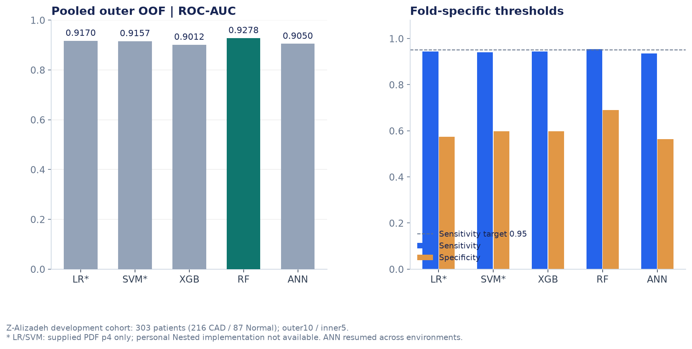
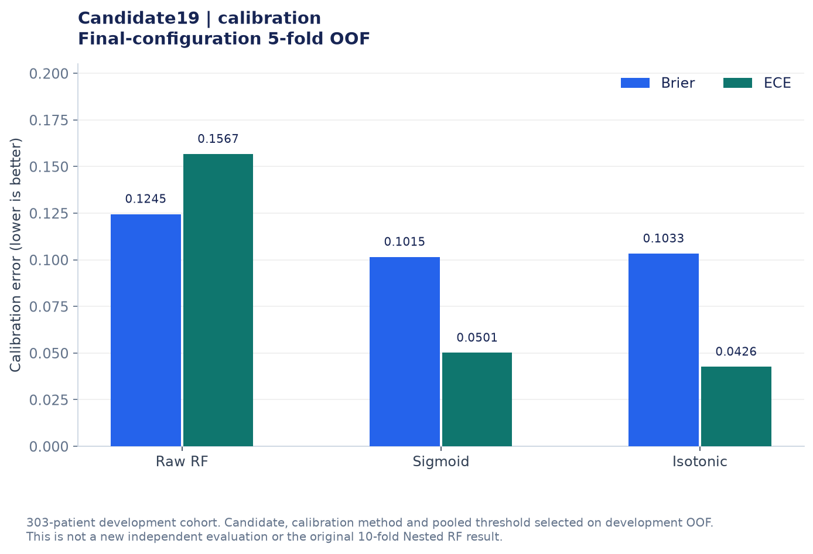

# Clinical RF | 실험 결과 및 평가 기준

임상정보 기반 관상동맥질환(CAD) 선별 모델의 학습·검증 결과를 정리했습니다.

이 프로젝트에서는 **303명의 임상 데이터**를 활용해 머신러닝 모델을 비교하고, Random Forest의 하이퍼파라미터와 확률 보정 방법을 검토했습니다.

모델 평가 과정은 크게 두 단계로 구분했습니다.

1. **Nested Cross-Validation:** XGBoost, Random Forest, ANN 모델의 성능 비교
2. **별도 5-fold OOF:** Random Forest 최종 후보 선택 및 확률 보정 방법 비교

두 단계는 검증 방식과 모델 설정이 다르므로 결과를 구분해 해석해야 합니다.

---

## 1. 데이터 및 평가 기준

### 사용 데이터

- **데이터셋:** Extension of Z-Alizadeh Sani
- **전체 데이터:** 303명
- **CAD:** 216명
- **Normal:** 87명
- **예측 대상:** `Cath` (Normal = 0, CAD = 1)
- **평가 단위:** 환자 단위

모델 성능을 평가할 때는 다음 지표를 사용했습니다.

| 평가 지표 | 의미 |
|---|---|
| Sensitivity | 실제 CAD 환자를 CAD로 분류한 비율 |
| Specificity | 실제 정상 환자를 정상으로 분류한 비율 |
| ROC-AUC | 양성과 음성을 구분하는 모델의 전반적인 판별 능력 |
| PR-AUC (AP) | Precision-Recall 관계를 Average Precision 방식으로 집계한 값 |
| Brier Score | 예측 확률과 실제 결과의 차이를 평가하는 지표 |
| ECE | 예측 확률과 관측 빈도 사이의 보정 오차를 구간별로 집계한 지표 |

CAD 선별을 목적으로 했기 때문에 Sensitivity와 False Negative(FN)를 우선적으로 살펴봤습니다.

다만 민감도를 높이기 위해 Threshold를 조정하면 Specificity가 낮아질 수 있으므로, 다른 성능 지표도 함께 비교했습니다.

---

## 2. Nested Cross-Validation 모델 비교

### 평가 방법

모델 선택 과정과 성능 평가 과정을 구분하기 위해 Nested Cross-Validation을 사용했습니다.

| 구분 | 설정 |
|---|---|
| Outer CV | 10-fold |
| Inner CV | 5-fold |
| 모델 선택 | Inner OOF 예측 결과 활용 |
| Threshold 선택 | Inner OOF에서 Sensitivity 95% 이상 우선 고려 |
| 최종 평가 | Outer Fold의 미사용 데이터 |
| 결과 집계 | 전체 Outer Fold의 OOF 예측 결과 |

각 Outer Fold에서 선택된 Threshold가 다를 수 있으므로, 전체 OOF 결과에 적용되는 단일 Threshold는 없습니다.

### 모델별 성능

| 모델 | Sensitivity | Specificity | PR-AUC (AP) | ROC-AUC |
|---|---:|---:|---:|---:|
| XGBoost | 0.9444 | 0.5977 | 0.9513 | 0.9012 |
| **Random Forest** | **0.9537** | **0.6897** | **0.9709** | **0.9278** |
| Keras ANN | 0.9352 | 0.5632 | 0.9609 | 0.9050 |



### 결과 분석

Random Forest는 이번 내부 평가에서 비교 모델 중 가장 높은 Sensitivity, Specificity, PR-AUC, ROC-AUC를 보였습니다.

특히 Sensitivity 0.9537은 전체 CAD 환자 216명 중 206명을 CAD로 분류하고, 10명을 놓친 결과입니다.

이 결과를 바탕으로 이후 실험에서는 Random Forest를 중심으로 최종 모델 구성을 진행했습니다.

다만 위 수치는 **Nested CV 기반 내부 검증 성능**이며, 별도의 외부 데이터에서 검증한 결과는 아닙니다.

관련 코드: [모델 비교 및 Nested CV 실험](../notebooks/preprocessing_keras_memory_safe.ipynb)

---

## 3. Random Forest 최종 구성과 확률 보정

### 평가 방법

Nested CV를 통한 알고리즘 비교 이후에는 전체 개발 데이터 303명을 이용해 별도의 5-fold OOF 실험을 진행했습니다.

Random Forest 후보 24개를 비교한 뒤 Candidate 19를 선택하고, 다음 세 가지 방법의 결과를 비교했습니다.

- Raw Random Forest
- Random Forest + Sigmoid Calibration
- Random Forest + Isotonic Calibration

이 단계에서는 분류 성능뿐 아니라 **출력 확률이 실제 결과와 얼마나 잘 일치하는지**를 확인하고자 Brier Score와 ECE를 함께 평가했습니다.

### 확률 보정 결과

| 방법 | Sensitivity | Specificity | ROC-AUC | Brier | ECE |
|---|---:|---:|---:|---:|---:|
| Raw RF | 0.9537 | 0.6782 | 0.9177 | 0.1245 | 0.1567 |
| **RF + Sigmoid** | **0.9583** | **0.6782** | 0.9127 | **0.1015** | 0.0501 |
| RF + Isotonic | 0.9537 | 0.6667 | 0.9170 | 0.1033 | **0.0426** |

각 방법의 Threshold도 서로 다릅니다.

| 방법 | Threshold |
|---|---:|
| Raw RF | 0.419485 |
| RF + Sigmoid | 0.3558017639 |
| RF + Isotonic | 약 0.3333 |



### 결과 분석

**Sigmoid Calibration**을 적용했을 때 Brier Score는 0.1245에서 0.1015로, ECE는 0.1567에서 0.0501로 감소했습니다.

Specificity는 0.6782로 유지하면서 Sensitivity는 0.9537에서 0.9583으로 증가했습니다.

이에 따라 False Negative는 10명에서 9명으로 줄었습니다.

다만 ROC-AUC는 0.9177에서 0.9127로 소폭 감소했습니다.

Isotonic Calibration은 ECE가 가장 낮았지만, Specificity는 다른 두 방법보다 낮았습니다.

이러한 결과를 종합해 **Sigmoid Calibration을 최종 보정 방법으로 선택했습니다.**

관련 코드: [Random Forest 최종 구성 및 확률 보정](../notebooks/RF/02_RF_최종검증_신규환자예측.ipynb)

---

## 4. 두 평가 단계의 차이

이번 실험에서 주의해야 할 부분은 Nested CV 결과와 최종 구성용 5-fold OOF 결과를 구분하는 것입니다.

| 구분 | Nested CV | 최종 구성용 5-fold OOF |
|---|---|---|
| 목적 | 알고리즘 비교 및 내부 성능 평가 | RF 후보 및 보정 방법 선택 |
| 교차검증 | Outer 10-fold / Inner 5-fold | 별도 5-fold |
| 주요 모델 | XGBoost, RF, ANN | RF Candidate 19 |
| RF Sensitivity | 0.9537 | Raw RF 0.9537 |
| RF Specificity | 0.6897 | Raw RF 0.6782 |
| RF ROC-AUC | 0.9278 | Raw RF 0.9177 |

두 실험은 같은 데이터셋을 활용했지만 모델 설정과 평가 과정이 다르기 때문에 하나의 결과로 합치지 않았습니다.

또한 최종 구성용 5-fold OOF에서는 RF 후보와 보정 방법, Threshold를 개발 데이터의 평가 결과를 참고해 선택했습니다.

따라서 이 단계에서 얻은 결과는 모델을 비교하고 최종 구성을 결정하기 위한 내부 실험 결과이며, **독립적인 최종 성능 검증 결과는 아닙니다.**

---

## 5. 결과 파일과 그래프

### 집계 결과

실험별 평가 수치는 [`metrics.csv`](metrics.csv)에 정리했습니다.

이 파일에는 모델명, 평가 단계, 데이터셋, 평가 지표 등이 포함되어 있습니다.

결과를 비교할 때는 모델명만 확인하기보다 다음 조건을 함께 살펴봐야 합니다.

- 사용 데이터셋 및 평가 대상
- 교차검증 방식
- 모델 선택 과정
- Threshold 결정 방식
- 평가 지표와 집계 기준

특히 Nested CV와 최종 구성용 OOF의 수치를 서로 동일한 조건에서 측정한 것처럼 비교하지 않도록 구분했습니다.

### 그래프 재생성

저장된 집계 결과를 이용해 성능 비교 그래프를 다시 생성할 수 있습니다.

저장소의 최상위 폴더에서 다음 명령을 실행합니다.

```bash
python scripts/plot_results.py
```

이 스크립트는 `results/metrics.csv`에 저장된 집계 데이터를 이용해 그래프를 생성합니다.

환자별 원본 데이터나 학습된 모델 파일을 불러와 새롭게 추론하는 과정은 포함하지 않습니다.

그래프의 생성 정보는 [Figure Manifest](../figures/manifest.json)에서 확인할 수 있습니다.

집계 수치만으로 실제 환자별 ROC 곡선이나 Calibration Curve를 복원할 수는 없으므로, 계산되지 않은 곡선이나 신뢰구간을 임의로 생성하지 않았습니다.

---

## 6. 결과 해석의 한계

이번 실험은 소규모 임상 데이터에서 모델 선택과 확률 보정 방법을 비교했다는 점에 의미가 있지만, 다음과 같은 한계가 있습니다.

**첫째, 독립적인 외부 검증이 수행되지 않았습니다.**

Nested CV를 통해 내부 평가를 진행했으나, 다른 기관이나 독립적인 환자 집단에서 동일한 성능이 나타나는지는 확인하지 못했습니다.

**둘째, 최종 RF 구성 결과에는 모델 선택의 영향이 남아 있습니다.**

최종 후보와 보정 방법을 개발 데이터의 OOF 결과를 기준으로 선택했으므로, 해당 수치를 편향 없는 최종 검증 성능으로 해석하기 어렵습니다.

**셋째, 모델 저장과 입력 구조 확인이 실제 추론 검증을 대신하지는 않습니다.**

모델 저장·재로딩 결과의 일관성은 확인했지만, 신규 Mock 입력의 예측과 잘못된 입력에 대한 처리 검증은 완료하지 못했습니다.

따라서 현재 결과는 임상 적용 성능을 입증하기보다, **데이터 전처리와 모델 평가, 확률 보정 방법을 비교한 개발 단계의 실험 결과**로 해석해야 합니다.

---

### 관련 문서

- [프로젝트 소개](../README.md)
- [실험 과정 및 검증 방법](../docs/experiments.md)
- [모델 비교 노트북](../notebooks/preprocessing_keras_memory_safe.ipynb)
- [Random Forest 최종 구성 노트북](../notebooks/RF/02_RF_최종검증_신규환자예측.ipynb)
- [데이터 출처 및 이용 조건](../docs/data_sources.md)
